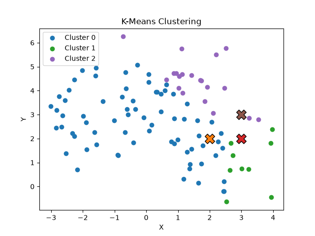
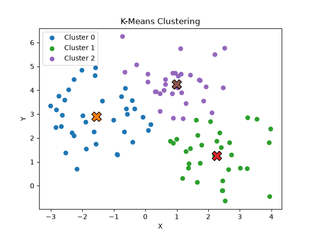

# K means clustering
This is a project to help me understand the basics of unsupervised learning.

It involves setting up random clusters of points using an sklearn dataset and groups them together into a pre specified number of clusters

## Process

* Centroids are initialised randomly
* Each data point is assigned the closest centroid. This is through euclidian distance
* Each centroid position is updated using the mean of all the data points in that cluster
* Repeat this process until the centroids don't move

## Examples
<table>
  <tr>
    <td align="center">
       
      <b>Start</b>
    </td>
    <td align="center">
       
      <b>End</b>
    </td>
  </tr>
</table>